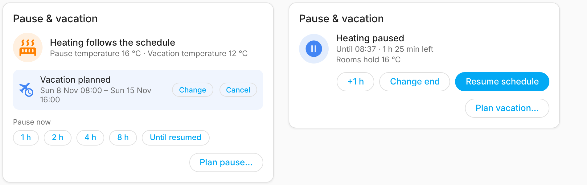

# Changelog

Each release's GitHub release notes are taken from its section below. Add a
`## <version>` section matching the version in `manifest.json` before the
release PR to `main` is merged.

## 0.4.1

A small fix for changing temperatures with the + and - buttons.

### Fixes

- **The temperature now stays where you put it.** When you pressed + or - a few times in a row, the temperature you picked would slowly step back down (or up) by itself a few seconds later. That's fixed: the new temperature shows right away and stays put. This works the same for a thermostat and for a room's at-home and away temperatures.

### Upgrading

Update in HACS and restart Home Assistant. Nothing else to do: your entities, dashboards and automations stay as they are.

## 0.4.0

You can now see and change the weekly schedule, and pause the heating, right from Home Assistant. Two new dashboard cards come with the integration, so there is nothing extra to install.

### Edit the weekly schedule

- **Schedule card:** edit a dashboard, choose **Add card** and search for **Danfoss Link**, then pick **Danfoss Link schedule**. It shows each room's week, one tab per room. Drag over the grid to paint *at home* or *away* time, drag down to change several days at once, and press **Save**.
- Rooms in the living zone share one tab, because the Danfoss controller gives them one shared schedule. Changing it changes it for all of them.
- For automations and scripts, use the new **Set schedule** action (`danfoss_link.set_schedule`). Give the weekdays and the *at home* periods, for example `06:00-08:00` and `16:00-22:30`. The rest of the day uses the away temperature.
- Every thermostat now shows its schedule: the `schedule_today` attribute lists today's *at home* periods, and `schedule` lists them for every weekday.

  

### Pause the heating, plan pauses and vacations

- **Pause & vacation card:** add **Danfoss Link pause & vacation** the same way. Pause for 1, 2, 4 or 8 hours with one tap, or until you resume. Plan a pause or a vacation for later, see what is planned and how long is left, add an hour, change the end, or resume the schedule. You can hide the pause or the vacation part in the card settings.
- While paused, every room holds the pause temperature set on your controller (6 °C unless you changed it). When the pause ends, the rooms go back to their schedule.
- For automations, use the **Pause** action (`danfoss_link.pause`) with a duration, an end time, or neither to pause until you resume. Add a start time to plan it for later. **Cancel pause** (`danfoss_link.cancel_pause`) ends or cancels it. The controller cannot plan a pause by itself, so Home Assistant keeps the plan and starts the pause on time, also after a restart.
- New **Pause start** and **Pause end** sensors hold the times, for use in automations.

  

### New sensors

- **Outdoor temperature**, if your controller has an outdoor sensor. Without one, no sensor is added.
- **Living zone** shows how many rooms are in the living zone and which ones. Rooms can still only be added or removed on the controller's own display. We tried doing it from Home Assistant, but the controller does not allow it over the network.
- The **House mode** select has a new `at_home_rooms` attribute listing the rooms that the current *At home* period covers.

### Fixes

- If you switched a room to Manual and back to Schedule while the house was *At home*, the room heated to its away temperature even though the house said *At home*. It now gets its at-home temperature again.
- The **House state** sensor shows **Manual** instead of *unknown* when the house is in manual mode.
- On/off devices, such as floor-heating relays, now show as unavailable while the controller reports "no response from unit" for them. Before, they looked as if they switched when nothing happened.
- Pause and vacation times follow the controller's own clock, which can run several minutes fast (one ran 18 minutes ahead). Before, a timed pause could end early.
- Danish names for the House state values.

### Upgrading

Update in HACS and restart Home Assistant. The cards load by themselves; if a dashboard says a Danfoss Link card can't be found, refresh the page. No entity IDs changed and no reconfiguration is needed.

## 0.3.1

### Fixes
- Short Danfoss relay drops no longer make entities unavailable. When the CC is briefly unreachable (`PEER_NOT_AVAILABLE`), the integration keeps the last known state for up to 5 minutes and retries every 15 seconds before marking entities unavailable. (#5)
- No more "deprecated `via_device` parameter" warnings on Home Assistant 2026.10 and later; rooms now link to the CC with `via_device_id`. (#3)
- README: the CC Wi-Fi signal sensor only appears on CCs that report it; firmware 4.2.1797 does not. (#4)

No entity IDs changed and no reconfiguration is needed.
