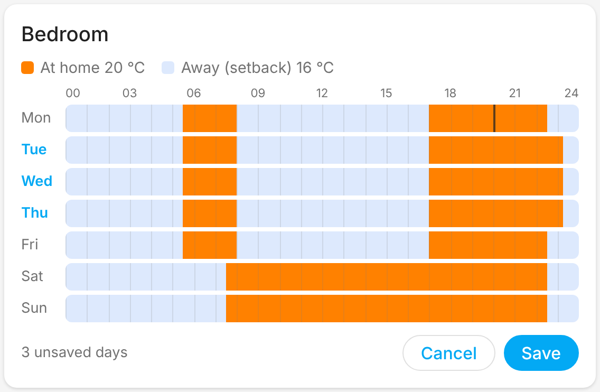

# Changelog

Each release's GitHub release notes are taken from its section below. Add a
`## <version>` section matching the version in `manifest.json` before the
release PR to `main` is merged.

## 0.4.0

### New
- **Set schedule** action (`danfoss_link.set_schedule`): change a room's weekly schedule from Home Assistant. Give the weekdays and the *at home* periods (e.g. `06:00-08:00`, `16:00-22:30`); the rest of the day is away (setback). A room in the living zone changes the whole zone's schedule.
- **Schedule card** for dashboards (`custom:danfoss-link-schedule-card`), included with the integration: see each room's week at a glance with its times, one tab per room (the living zone shares one), and drag to change at home and away periods.

  

- **Pause heating** now or later: the `danfoss_link.pause` action pauses for a duration (e.g. 2 hours), until a time, or until you resume, as the app's Pause does, and can plan a pause to start later (Home Assistant keeps the plan and starts the pause then, as the CC cannot plan one itself). `danfoss_link.cancel_pause` ends or cancels it. Every room holds the pause temperature meanwhile. New **Pause start** / **Pause end** sensors, and the house mode select shows pause and vacation state, times and temperatures as attributes.
- **Pause & vacation card** for dashboards (`custom:danfoss-link-away-card`), included with the integration: pause for 1, 2, 4 or 8 hours with one tap or until you resume, plan a pause or a vacation, see what is planned and how long is left, change or cancel it. Pause or vacation can be hidden in the card settings.
- **Outdoor temperature** sensor, on setups whose Danfoss controller has an outdoor sensor. Without one, no sensor is added.
- **Living zone** sensor: how many rooms are in the living zone (they share one mode and schedule), with the rooms, the other rooms, the zone's mode and schedule as attributes. Rooms are still added or removed on the Danfoss controller's display; it accepts no such change over the network.
- **Living zone card** for dashboards (`custom:danfoss-link-living-zone-card`), included with the integration: the zone's rooms and the other rooms with their temperatures, today's at home times, and one tap to switch the zone between schedule and manual.

### Fixes
- A room you switch to Manual and then back to Schedule while the house is *At home* now gets its at-home temperature again. Before, the Danfoss controller quietly left that room out of *At home*, so it heated to its away temperature even though the house said At home.
- The House state sensor shows **Manual** instead of *unknown* when the CC reports a manual house state.
- On/off devices (e.g. floor-heating relays) show as unavailable while the CC reports "no response from unit" for them, instead of looking like they switched when nothing happened.
- Pause and vacation times follow the CC's own clock. Danfoss controllers can run minutes fast (one ran 18 minutes ahead), which made a timed pause end early and vacation times show off by as much.

### Improvements
- Each thermostat shows its weekly schedule: the `schedule_today` attribute lists today's *at home* periods (e.g. `06:00-08:00`, `16:00-22:30`) and `schedule` lists them for every weekday. The rest of the day is the away (setback) temperature.
- The House mode select has a new `at_home_rooms` attribute listing the rooms the current *At home* period covers.
- Danish names for the House state values.

No entity IDs changed and no reconfiguration is needed.

## 0.3.1

### Fixes
- Short Danfoss relay drops no longer make entities unavailable. When the CC is briefly unreachable (`PEER_NOT_AVAILABLE`), the integration keeps the last known state for up to 5 minutes and retries every 15 seconds before marking entities unavailable. (#5)
- No more "deprecated `via_device` parameter" warnings on Home Assistant 2026.10 and later; rooms now link to the CC with `via_device_id`. (#3)
- README: the CC Wi-Fi signal sensor only appears on CCs that report it; firmware 4.2.1797 does not. (#4)

No entity IDs changed and no reconfiguration is needed.
