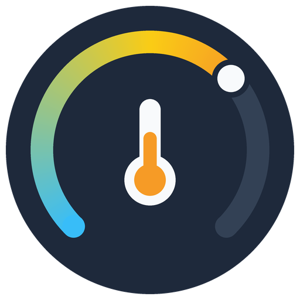

<p align="center">
  
</p>

# Danfoss Link for Home Assistant

[](https://my.home-assistant.io/redirect/hacs_repository/?owner=Ole-JH&repository=ha-danfoss-link&category=integration)
[](https://my.home-assistant.io/redirect/config_flow_start/?domain=danfoss_link)

Control a **Danfoss Link CC** (central controller) and everything paired to it
(Link Connect radiator thermostats, Link RS room sensors, Link FT floor thermostats,
Link HC, on/off plugs) from Home Assistant, without the Danfoss Link app.

Danfoss has discontinued the Link system and does not offer a Home Assistant
integration. This custom integration does what the phone app does: it connects through
the Danfoss cloud relay to your CC and calls the same internal REST API. It has been
confirmed working against a real Link CC.

> **Unofficial.** Not affiliated with Danfoss or Trifork. It is based on reverse
> engineering and can stop working if Danfoss turns off the relay servers. You are
> changing real heating settings: use at your own risk.

## Quick start

You need Home Assistant 2025.7 or newer with [HACS](https://hacs.xyz), and a Link CC
that is online. You don't need your phone or the Danfoss Link app.

1. **Add the repository to HACS.** Click the first blue button above (or in HACS go to
   ⋮ → Custom repositories and add `https://github.com/Ole-JH/ha-danfoss-link` as an
   *Integration*).
2. **Download** Danfoss Link in HACS, then **restart Home Assistant**.
3. **Add the integration.** Click the second blue button above (or Settings → Devices &
   services → Add integration → **Danfoss Link**) and choose
   **Pair with the code from the CC**.
4. **Get a code from the CC.** On the CC's touch screen, start pairing a new app, the
   same way you once paired your phone. The CC shows a pairing code. Codes expire
   quickly, so have Home Assistant open and ready.
5. **Enter the code** in Home Assistant (dashes and spaces don't matter) and submit.
   Home Assistant pairs, connects through the Danfoss cloud and reads your rooms before
   it saves anything.

That's it. See [What to expect afterwards](#what-to-expect-afterwards) for what shows
up, and [Troubleshooting](#troubleshooting) if a step fails.

## What you get

| Entity | Per | What it does |
|---|---|---|
| `climate` | room | Current and target temperature. **Auto** = Schedule, **Heat** = Manual (see [Modes](#what-to-expect-afterwards)). Shows whether the room is heating. |
| `sensor` temperature | room | Room temperature for history/statistics |
| `select` mode | room | **Schedule** / **Manual**, the same setting as the thermostat's Auto/Heat, for dashboards and automations |
| `number` at-home / away temperature | room | The two temperatures the schedule switches between |
| `select` house mode | CC | Schedule (no override) / At home / Vacation / Pause (/ Boost if your CC has it) |
| `sensor` house state | CC | What the CC is doing now: at home / away / asleep from the schedule, or the active mode |
| `number` vacation temperature | CC | Temperature used in vacation mode |
| `sensor` vacation start / end | CC | When a planned or running vacation starts and ends; unknown when none is planned |
| `switch` | on/off device | Link on/off outputs |
| `sensor` unread alarms | CC | Count plus details (low battery, lost device, ...) |
| `button` mark alarms as read | CC | Marks every unread alarm as read, as opening it in the app does |
| `binary_sensor` living zone | room | On when the room is in the living zone. Its rooms share one Schedule/Manual mode and one schedule, so changing one changes all. |
| `binary_sensor` battery | room | Low battery on a device in the room, from the CC's alarms. *Disabled by default.* |
| `binary_sensor` radio connection | room | Off when the CC has lost contact with a device in the room. *Disabled by default.* |
| `sensor` Wi-Fi signal | CC | The CC's Wi-Fi signal strength. *Disabled by default.* |

### Planned vacation

Plan a vacation ahead with the **Danfoss Link: Plan vacation** action
(`danfoss_link.plan_vacation`), just like the app's vacation calendar. The CC
switches to vacation mode at the start time and back to the schedule at the
end. **Cancel vacation** (`danfoss_link.cancel_vacation`) removes the plan or
ends a running vacation.

```yaml
action: danfoss_link.plan_vacation
data:
  start: "2026-12-20 08:00:00"
  end: "2026-12-27 16:00:00"
```

Diagnostic entities marked *disabled by default* can be turned on under the
device's entity list in Home Assistant.

Each room is its own device (linked to the CC device), so you can put it in an area.
Polling runs every 60 s by default (configurable down to 20 s); changes are sent
immediately.

### Feature coverage

How the integration compares with the Danfoss Link app (1.3.x).

| App feature | In Home Assistant | Notes |
|---|---|---|
| Room temperature and target temperature | ✅ | `climate` entity and temperature sensor |
| Schedule / Manual per room | ✅ | Thermostat Auto/Heat and the room's Mode select |
| At-home / away temperatures | ✅ | Number entities per room |
| Living zone (shared mode for its rooms) | ✅ | Mode changes are sent to the whole zone |
| House modes: at home, vacation, pause, boost | ✅ | House mode select and house state sensor |
| Vacation temperature | ✅ | Number entity |
| Planned vacation with dates | ✅ | `plan_vacation` / `cancel_vacation` actions |
| On/off devices | ✅ | Switch entities |
| Alarms (low battery, lost device, ...) | ✅ | A notification per unread alarm, unread alarms sensor, battery and radio connection binary sensors |
| Mark alarms as read | ✅ | Dismiss the notification, or press the Mark alarms as read button. Notifications can be turned off in the integration's options |
| CC Wi-Fi signal | ✅ | Diagnostic sensor |
| Pair a new app with a CC code | ✅ | Config flow (cloud pairing codes only) |
| Weekly schedules (rooms, living zone) | ❌ | Not yet; the CC's API supports it |
| Schedules for on/off devices | ❌ | Not yet |
| Pause with an end time | ❌ | Pause can only be switched on and off |
| Outdoor temperature | ❌ | Not yet |
| Pause temperature, floor heating limit | ❌ | The app only reads these; not planned |
| Firmware update | ❌ | Not planned: a failed update could leave the CC unreachable |
| LAN pairing (`0000` codes) | ❌ | Not supported |
| Push notifications, multiple homes, renaming | ➖ | Use Home Assistant's own notifications, config entries and names |

## How it works

```
Home Assistant ──mTLS──► Danfoss MDG relay (77.66.11.x / 5.179.92.x : 443)
               ══ end-to-end TLS tunnel ══► Link CC ──► http://127.0.0.1:8000/api/...
```

The CC has no local API: it closes all LAN ports and only talks to the relay. To get
through, Home Assistant needs an identity (a client certificate and key) that your CC
has paired with. There are two ways to get one:

- **Pair with the code from the CC (default).** Home
  Assistant creates its own identity and pairs it with the CC using the code the CC
  shows, the way the app pairs a new phone. No Android device needed, and your phone
  app keeps its own pairing.
- **Use exported app credentials.** Borrow the identity of an already paired Android
  app (needs root or an emulator). Use this if pairing does not work for you.

Technical details are in [NOTICE.md](NOTICE.md), [docs/protocol.md](docs/protocol.md)
and the docstrings in `custom_components/danfoss_link/api/`.

## Installation details

**HACS (recommended):** see [Quick start](#quick-start). HACS will offer updates like
any other integration.

**Manual:** copy `custom_components/danfoss_link` into your `config/custom_components/`
and restart Home Assistant.

## Pairing details

Home Assistant is paired as its own app (it introduces itself to the CC as "Home
Assistant"), separate from your phone's pairing, so the phone app keeps working
alongside it.

- The CC must be connected to the internet: pairing goes through the Danfoss cloud.
- Codes starting with `0000` are for pairing on the local network, which is not
  supported. Use a code for pairing through the cloud.
- If pairing worked but the first connection fails, the form lets you retry without a
  new code.
- If pairing doesn't work for you at all, please open an issue with debug logs and use
  the [exported app credentials](#alternative-use-exported-app-credentials) in the
  meantime.

## What to expect afterwards

- **Devices.** One device for the CC, and one device per room as named on the CC, linked
  to it. Put each room device in the matching Home Assistant area.
- **Entities.** Each room gets a thermostat card (`climate`) with the current and target
  temperature, plus the entities listed under [What you get](#what-you-get).
- **Modes.** Each room is either on **Schedule** or **Manual**, the same choice as in
  the Danfoss Link app. Home Assistant only allows fixed names for thermostat modes, so
  the thermostat card shows them as **Auto** (= Schedule) and **Heat** (= Manual). The
  room's **Mode** select shows the same setting by its real name; changing either one
  changes both.
  - **Schedule / Auto**: the room follows the CC's weekly program, switching between the
    at-home and away temperatures. Changing the target temperature only lasts until the
    next switch in the program.
  - **Manual / Heat**: the room holds the temperature you set until you change it.

  Changes are sent to the CC right away; battery thermostats may take a little while to
  follow, just as with the app.
- **Updates.** Home Assistant reads the CC every 60 seconds. You can change this under
  **Configure** on the integration (down to 20 seconds); every poll goes through the
  Danfoss cloud.
- **Your phone app** keeps its own pairing and keeps working. Changes made in the app or
  on the CC show up in Home Assistant at the next poll.
- **If the internet or the Danfoss cloud is down,** the entities become unavailable and
  recover on their own when the connection is back. The CC keeps heating on its own
  schedule in the meantime.

## Alternative: use exported app credentials

If pairing doesn't work for you, Home Assistant can borrow the identity of an Android
install of the Danfoss Link app that is **paired with your CC**. You need three things
from it: `app_cert.pem`, `app_key.pem` and the CC peer ID. They live in the app's
private storage, so you need root access to that Android: a rooted phone or, easier,
the Android emulator on a PC/Mac.

1. **Get the app.** Install Danfoss Link from Google Play on your own phone if it is
   still listed for you, then copy the APK off it (no root needed):
   ```bash
   adb shell pm path com.danfoss.linkapp           # prints package:/data/app/.../base.apk
   adb pull /data/app/.../base.apk danfoss-link.apk
   ```
   If it is no longer available, only use an APK from a source you trust.
2. **Create an emulator** in Android Studio → Device Manager with a
   **"Google APIs"** system image (not "Google Play": Play images refuse `adb root`).
   On an Apple Silicon Mac use an **arm64-v8a** image. On an Intel/AMD PC use an
   **x86_64** image of Android 11 or newer, which can run ARM apps.
3. Start it, then `adb install danfoss-link.apk`.
4. **Pair** the app with your CC as you did on your phone. The PC must be on the same
   network as the CC. Check that your rooms show up.
5. **Export** with the script in this repository:
   ```bash
   ./scripts/export_credentials.sh ~/danfoss_link_creds
   ```
   It prints the CC peer ID (looks like `e7:af:e3:77:...`, 20 bytes) and saves the two
   PEM files. Manual alternative: the files are in
   `/data/data/com.danfoss.linkapp/files/luadata/`, and the peer ID is in the file in
   `pairings/` (`["peer_id"]="..."`) or is that file's name with `_` instead of `:`.
6. **Close the app** (and shut the emulator down). The relay allows one connection
   per identity, so the app and Home Assistant would keep kicking each other off. Don't
   remove the pairing or re-pair the app; that invalidates the exported identity.
7. Settings → Devices & services → Add integration → **Danfoss Link** →
   **Use exported app credentials**. Paste the contents of `app_cert.pem` and
   `app_key.pem` and the peer ID. Instead of pasting, you can copy the files to your
   config folder and enter a path such as `danfoss_link_creds/app_cert.pem`. The form
   checks the key against the certificate and connects to the CC before saving.

If you re-pair the app later, use **Reconfigure** on the integration to paste the new
files.

Treat `app_key.pem` like a password: anyone with it can control your heating. The same
goes for the key Home Assistant creates when pairing, which is stored in its config entry.

## Troubleshooting

| Error | Meaning |
|---|---|
| *No CC is waiting for this code* | The code expired or was mistyped (everything but the last five characters identifies the CC). Start pairing on the CC again. |
| *The CC rejected the code* | The last five characters of the code didn't match. Check the code and retry, or get a new one. |
| *Codes starting with 0000...* | That is a local-network pairing code, which is not supported. |
| *Invalid credentials* | A PEM is incomplete, the key doesn't belong to the certificate, or the peer ID isn't 20 hex bytes. |
| *CC offline* | The relay accepted the identity but cannot reach your CC: check its internet connection and the peer ID. |
| *Cannot connect* | The relay could not be reached, or another client (the app) is using this identity. Close the app and retry. Outbound TCP 443 to `77.66.11.90/92` and `5.179.92.180/182` must be allowed. |

For more detail, enable debug logging:

```yaml
logger:
  logs:
    custom_components.danfoss_link: debug
```

Diagnostics (⋮ → Download diagnostics) redact the key, certificate, peer ID and
serial number.

## Known limitations

- **Cloud dependent.** Danfoss still ships CC firmware (4.2.1797, Feb 2025) and the
  relay works today, but there is no promise it stays up.
- **Pairing uses the cloud relay only.** Remote pairing (PACE on brainpoolP320r1)
  works against a real CC; LAN pairing codes (`0000...`) are not supported.
- **Peer certificate not validated.** Like the app, the integration uses a custom TLS
  stack (the CC's brainpoolP320r1 certificates are unsupported by OpenSSL). It checks the
  handshake signatures but does not verify the relay's or the CC's certificate chain,
  so a man-in-the-middle on the network path is not ruled out.
- **Tested on one setup so far.** It is confirmed on a real Link CC, but the message
  formats come from reverse engineering and other device mixes may behave differently.
  Please open an issue with debug logs if anything doesn't work with your CC.
- Schedules can't be edited from Home Assistant yet (the API supports it).

## Alternatives

If you would rather leave the cloud entirely: plain Z-Wave "Living Connect" thermostats
(014G0013 / LC-13) can be factory reset and included directly in Z-Wave JS. Link-branded
devices (014G0001/0002 thermostats, Link RS/FT/HC) use a proprietary protocol and only
work with the CC.

## Development

```bash
pip install -r requirements_test.txt
ruff check . && ruff format --check .
pytest
```

The tests run the real client against `tests/fake_mdg.py`, a local fake of the relay
and CC (including the CC's side of pairing) that uses OpenSSL on the server side.

The icon is original artwork, not the Danfoss logo. `scripts/generate_icons.py`
renders it into `custom_components/danfoss_link/brand/` (shown by Home Assistant 2026.3
and newer) and `docs/images/` (README header and GitHub social preview).
