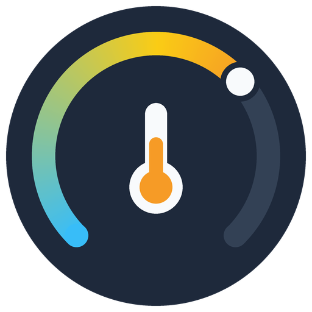

  

# Danfoss Link for Home Assistant

Control a **Danfoss Link CC** (central controller) and everything paired to it
(Link Connect radiator thermostats, Link RS room sensors, Link FT floor thermostats,
Link HC, on/off plugs) from Home Assistant, without the Danfoss Link app.

Danfoss has discontinued the Link system and does not offer a Home Assistant
integration. This custom integration does what the phone app does: it connects through
the Danfoss cloud relay to your CC and calls the same internal REST API. It has been
confirmed working against a real Link CC.

> **Unofficial.** Not affiliated with Danfoss or Trifork. It is based on reverse
> engineering and can stop working if Danfoss turns off the relay servers. You are
> changing real heating settings: use at your own risk.

## Quick start

You need Home Assistant 2025.7 or newer with [HACS](https://hacs.xyz), and a Link CC
that is online. You don't need your phone or the Danfoss Link app.

1. **Add the repository to HACS.** Click the first blue button above (or in HACS go to
   ⋮ → Custom repositories and add `https://github.com/Ole-JH/ha-danfoss-link` as an
   *Integration*).
2. **Download** Danfoss Link in HACS, then **restart Home Assistant**.
3. **Add the integration.** Click the second blue button above (or Settings → Devices &
   services → Add integration → **Danfoss Link**) and choose
   **Pair with the code from the CC**.
4. **Get a code from the CC.** On the CC's touch screen, start pairing a new app, the
   same way you once paired your phone. The CC shows a pairing code. Codes expire
   quickly, so have Home Assistant open and ready.
5. **Enter the code** in Home Assistant (dashes and spaces don't matter) and submit.
   Home Assistant pairs, connects through the Danfoss cloud and reads your rooms before
   it saves anything.

That's it. If a step fails, see [Troubleshooting](docs/troubleshooting.md). If pairing
doesn't work for you at all, you can [use exported app credentials](docs/exported-credentials.md)
instead.

**Manual install:** copy `custom_components/danfoss_link` into your
`config/custom_components/` and restart Home Assistant.

## What you get

Each room on the CC becomes a device with:

- a **thermostat** (`climate`) with current and target temperature. **Auto** means the
  room follows the CC's schedule, **Heat** means it holds the temperature you set;
- a room temperature sensor, a Schedule/Manual select, and the at-home and away
  temperatures.

The CC itself gets the house mode (at home, vacation, pause), vacation temperature and
planned vacation dates, alarms, and switches for Link on/off plugs. Home Assistant
reads the CC every 60 seconds and sends changes right away. Your phone app keeps
working alongside it.

The full entity list, what the app can do that Home Assistant can't yet, and how the
modes behave are in [docs/features.md](docs/features.md).

## Documentation

- [Entities and features](docs/features.md): every entity, planned vacations, feature
  coverage compared with the app, and what to expect after setup.
- [Troubleshooting](docs/troubleshooting.md): error messages, debug logging and
  diagnostics.
- [Use exported app credentials](docs/exported-credentials.md): the alternative to
  pairing, using the identity of a paired Android app.
- [How it works](docs/how-it-works.md): the cloud relay, pairing details, known
  limitations and cloud-free alternatives.
- [Development](docs/development.md): running the tests and linters.
- Protocol notes: [protocol.md](docs/protocol.md) and
  [connection-spec.md](docs/connection-spec.md).
