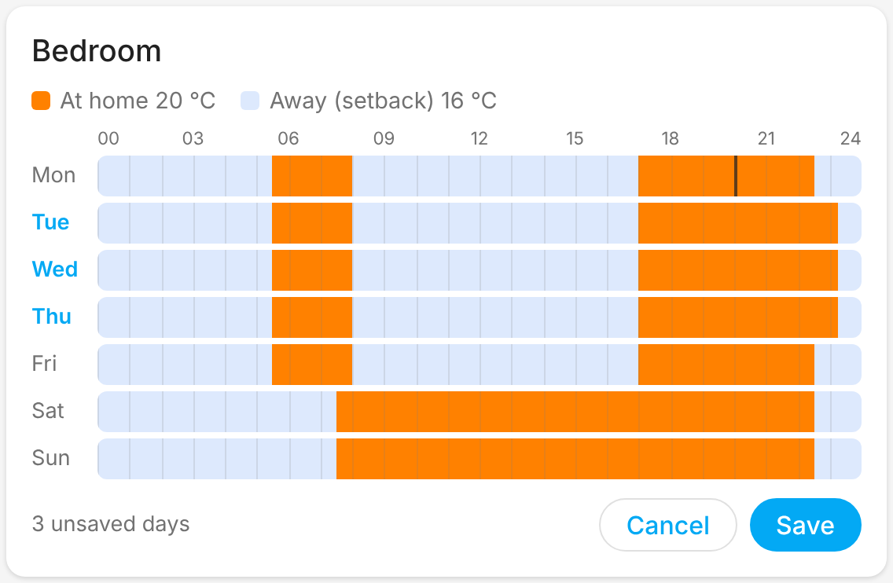

# Entities and features

| Entity | Per | What it does |
|---|---|---|
| `climate` | room | Current and target temperature. **Auto** = Schedule, **Heat** = Manual (see [Modes](#modes)). Shows whether the room is heating. |
| `sensor` temperature | room | Room temperature for history/statistics |
| `select` mode | room | **Schedule** / **Manual**, the same setting as the thermostat's Auto/Heat, for dashboards and automations |
| `number` at-home / away temperature | room | The two temperatures the schedule switches between |
| `select` house mode | CC | Schedule (no override) / At home / Vacation / Pause (/ Boost if your CC has it) |
| `sensor` house state | CC | What the CC is doing now: at home / away / asleep from the schedule, or the active mode |
| `number` vacation temperature | CC | Temperature used in vacation mode |
| `sensor` pause end | CC | When a running pause ends; unknown when there is no pause or it runs until you resume |
| `sensor` vacation start / end | CC | When a planned or running vacation starts and ends; unknown when none is planned |
| `switch` | on/off device | Link on/off outputs; unavailable while the CC reports "no response from unit" for them |
| `sensor` unread alarms | CC | Count plus details (low battery, lost device, ...) |
| `button` mark alarms as read | CC | Marks every unread alarm as read, as opening it in the app does |
| `binary_sensor` living zone | room | On when the room is in the living zone. Its rooms share one Schedule/Manual mode and one schedule, so changing one changes all. |
| `binary_sensor` battery | room | Low battery on a device in the room, from the CC's alarms. *Disabled by default.* |
| `binary_sensor` radio connection | room | Off when the CC has lost contact with a device in the room. *Disabled by default.* |
| `sensor` Wi-Fi signal | CC | The CC's Wi-Fi signal strength. *Disabled by default.* Only created if the CC reports it; firmware 4.2.1797 does not. |

## Planned vacation

Plan a vacation ahead with the **Danfoss Link: Plan vacation** action
(`danfoss_link.plan_vacation`), just like the app's vacation calendar. The CC
switches to vacation mode at the start time and back to the schedule at the
end. **Cancel vacation** (`danfoss_link.cancel_vacation`) removes the plan or
ends a running vacation.

```yaml
action: danfoss_link.plan_vacation
data:
  start: "2026-12-20 08:00:00"
  end: "2026-12-27 16:00:00"
```

## Weekly schedule

Each thermostat shows its schedule in the `schedule_today` and `schedule`
attributes: the *at home* periods per weekday. The rest of the day is away,
i.e. the room's away (setback) temperature.

Change it with the **Danfoss Link: Set schedule** action
(`danfoss_link.set_schedule`). It replaces the chosen days with the given at
home periods (`HH:MM-HH:MM` in 15-minute steps, `24:00` for the end of the
day) and fills the rest with away, like the app's schedule editor. Leave
`at_home` empty for away all day. Rooms in the living zone share one schedule,
so changing one of them changes them all.

```yaml
action: danfoss_link.set_schedule
target:
  entity_id: climate.bedroom
data:
  days: [monday, tuesday, wednesday, thursday, friday]
  at_home: ["05:30-08:00", "17:00-22:30"]
```

### Schedule card

The integration also brings a dashboard card for the schedule; nothing extra
to install. Edit a dashboard, add a card and pick **Danfoss Link schedule**.
By default it shows every Danfoss Link thermostat, one tab per room; the
living zone's rooms share one tab, as they share one schedule. Pick
thermostats in the card settings to show only those.

Each *at home* block shows its start and end time. Drag over the grid to
paint *at home* or *away*; drag down to change several days at once.
**Save** sends the changed days with the `set_schedule` action.



```yaml
type: custom:danfoss-link-schedule-card
# Optional; leave out for every Danfoss Link thermostat.
entities:
  - climate.bedroom
  - climate.bathroom
```

### Pausing the heating

Pause, as in the app, sets every room (Manual ones too) to the CC's pause
temperature (6 °C by default) until the pause ends, then the CC follows its
weekly schedule again. A pause replaces *At home* and *Vacation*.

- **House mode → Pause** pauses until you pick another house mode.
- The `danfoss_link.pause` action targets the house mode select and takes a
  `duration` or an `end`, or neither to pause until resumed. Pausing again
  while paused moves the end. Resume by selecting **Schedule** (or another
  house mode).
- The house mode select has `pause_end` and `pause_temperature` attributes,
  and the **Pause end** sensor holds the end time for automations.

```yaml
action: danfoss_link.pause
target:
  entity_id: select.my_home_house_mode
data:
  duration: "02:00:00"
```

### Pause card

A second dashboard card, **Danfoss Link pause**, comes with the integration.
It shows whether the heating is paused, until when and how long is left, and
the pause temperature. Pause for 1, 2, 4 or 8 hours with one tap, until a
time you pick, or until you resume; while paused, add an hour, change the end
or resume the schedule.

```yaml
type: custom:danfoss-link-pause-card
# Optional; leave out for the (first) Danfoss Link house mode.
entity: select.my_home_house_mode
# Optional quick choices, in hours.
durations: [1, 2, 4, 8]
```

Diagnostic entities marked *disabled by default* can be turned on under the
device's entity list in Home Assistant.

Each room is its own device (linked to the CC device), so you can put it in an area.
Polling runs every 60 s by default (configurable down to 20 s); changes are sent
immediately.

## Feature coverage

How the integration compares with the Danfoss Link app (1.3.x).

| App feature | In Home Assistant | Notes |
|---|---|---|
| Room temperature and target temperature | ✅ | `climate` entity and temperature sensor |
| Schedule / Manual per room | ✅ | Thermostat Auto/Heat and the room's Mode select |
| At-home / away temperatures | ✅ | Number entities per room |
| Living zone (shared mode for its rooms) | ✅ | Mode changes are sent to the whole zone |
| House modes: at home, vacation, pause, boost | ✅ | House mode select and house state sensor |
| Pause with an end time | ✅ | `pause` action and the pause card |
| Vacation temperature | ✅ | Number entity |
| Planned vacation with dates | ✅ | `plan_vacation` / `cancel_vacation` actions |
| On/off devices | ✅ | Switch entities |
| Alarms (low battery, lost device, ...) | ✅ | A notification per unread alarm, unread alarms sensor, battery and radio connection binary sensors |
| Mark alarms as read | ✅ | Dismiss the notification, or press the Mark alarms as read button. Notifications can be turned off in the integration's options |
| CC Wi-Fi signal | ⚠️ | Diagnostic sensor, only on CCs that report it (not firmware 4.2.1797) |
| Pair a new app with a CC code | ✅ | Config flow (cloud pairing codes only) |
| Weekly schedules (rooms, living zone) | ✅ | Shown as thermostat attributes, changed with the `set_schedule` action |
| Schedules for on/off devices | ❌ | Not yet |
| Outdoor temperature | ❌ | Not yet |
| Pause temperature, floor heating limit | ❌ | The app only reads these; not planned |
| Firmware update | ❌ | Not planned: a failed update could leave the CC unreachable |
| LAN pairing (`0000` codes) | ❌ | Not supported |
| Push notifications, multiple homes, renaming | ➖ | Use Home Assistant's own notifications, config entries and names |

## What to expect after setup

- **Devices.** One device for the CC, and one device per room as named on the CC, linked
  to it. Put each room device in the matching Home Assistant area.
- **Entities.** Each room gets a thermostat card (`climate`) with the current and target
  temperature, plus the entities listed [above](#entities-and-features).
- <a id="modes"></a>**Modes.** Each room is either on **Schedule** or **Manual**, the same choice as in
  the Danfoss Link app. Home Assistant only allows fixed names for thermostat modes, so
  the thermostat card shows them as **Auto** (= Schedule) and **Heat** (= Manual). The
  room's **Mode** select shows the same setting by its real name; changing either one
  changes both.
  - **Schedule / Auto**: the room follows the CC's weekly program, switching between the
    at-home and away temperatures. Changing the target temperature only lasts until the
    next switch in the program.
  - **Manual / Heat**: the room holds the temperature you set until you change it.

  Changes are sent to the CC right away; battery thermostats may take a little while to
  follow, just as with the app.
- **Updates.** Home Assistant reads the CC every 60 seconds. You can change this under
  **Configure** on the integration (down to 20 seconds); every poll goes through the
  Danfoss cloud.
- **Your phone app** keeps its own pairing and keeps working. Changes made in the app or
  on the CC show up in Home Assistant at the next poll.
- **If the internet or the Danfoss cloud is down,** the entities become unavailable and
  recover on their own when the connection is back. The CC keeps heating on its own
  schedule in the meantime.
